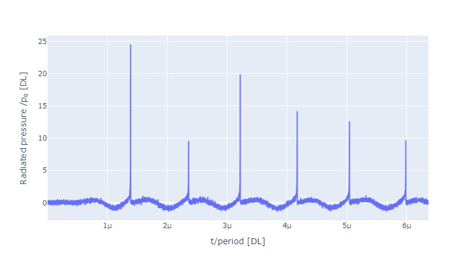
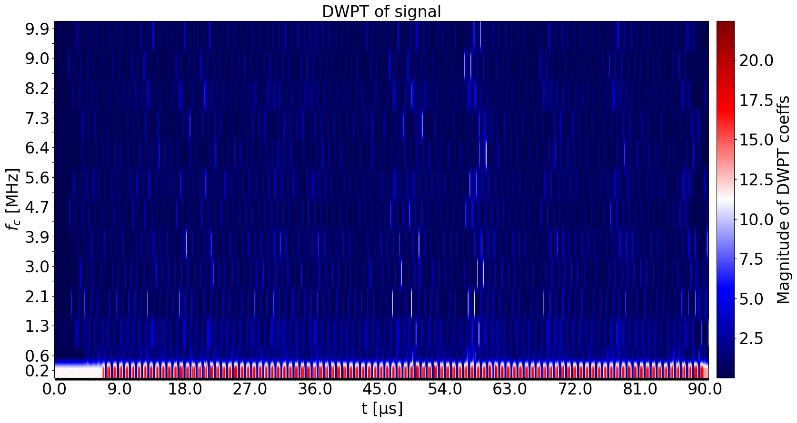
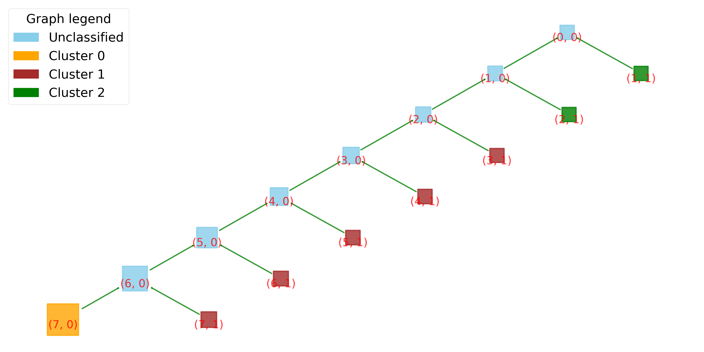
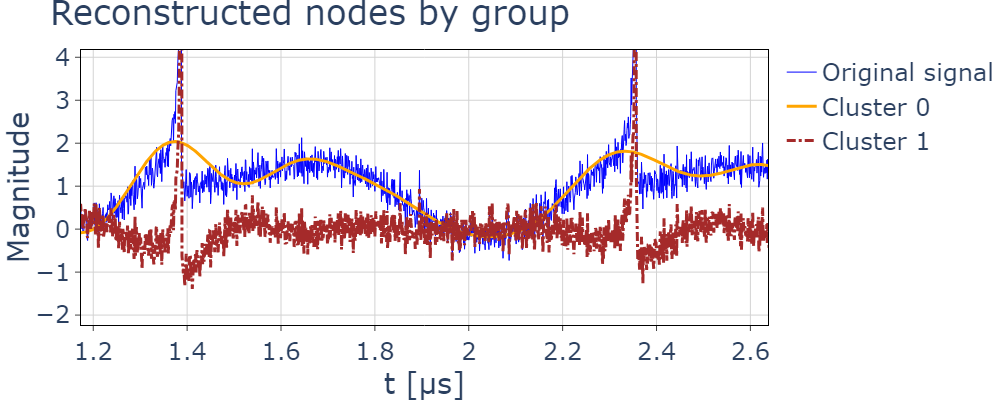

# WPT-Cavitation

A python library for wavelet transforms and machine learning for 1D time-seriers data. 

The main features are:

- a 1D implementation of the discrete wavelet packet transform (DWPT) and wavelet transform (DWT)
- inverse transforms which can reconstructed selected nodes individually
- minimum entropy decomposition
- decomposition for nodes under a selected frequency threshold
- statistical features of node data
- bubble dynamics simulations with the Gilmmore-Akulichev model
- visualisation with tree diagrams and spectrograms
- classification of nodes with clustering algorithms

The wavelet transform has been tested against results from the PyWavelets library and matlab although the implementation only relies on filter coefficients from PyWavelets.

This library was developed as part of an ongoing project associated with a published paper in Applied Acoustics (2027), see below for details. This project is partially funded by the Focused Ultrasound Foundation.

## Examples

Bubble dynamics simulation:


Heisenberg plot of wavelet packet transform:


Tree plot of wavelet transform with node size corresponding to the energy in the node:


Reconstructed data:


## Installation & Setup

This project requires a specific set of data science, signal processing, and graph visualization libraries. Follow the instructions below to configure your local workspace.

### Prerequisites

This repository utilizes **PyGraphviz** for graph rendering, which relies on system-level binaries. Before installing the Python packages, you **must** install the native Graphviz application on your machine:

* **Linux (RHEL / Fedora):**
  ```bash
  sudo dnf install graphviz graphviz-devel
  ```
* **Linux (Ubuntu / Debian):**
  ```bash
  sudo apt update && sudo apt install graphviz libgraphviz-dev
  ```
* **macOS (via Homebrew):**
  ```bash
  brew install graphviz
  ```
* **Windows:** Download and run the official installer from the [Graphviz Downloads Page](https://graphviz.org). Ensure you check the option to *"Add Graphviz to the system PATH"*.

---

### Option 1: Setup via Micromamba / Mamba / Conda (Recommended)

If you use (Micro) Mamba or Conda, you can instantly create an isolated workspace with all dependencies (including Python and system requirements) perfectly resolved.

1. **Clone the repository and enter the directory.**

2. **Create the environment from the configuration file:**
   ```bash
   mamba env create -f environment.yml
   ```
   *(If you use standard Conda, simply swap `mamba` for `conda`).*

3. **Activate the environment:**
   ```bash
   mamba activate wpt-cavitation-env
   ```

---

### Option 2: Setup via Standard Pip

If you prefer standard Python virtual environments, use the `requirements.txt` workflow. Ensure you have completed the **Prerequisites** step above first.

1. **Clone the repository and enter the directory.**

2. **Create and activate a clean virtual environment:**
   ```bash
   python3 -m venv wpt-cavitation-env
   source wpt-cavitation-env/bin/activate
   ```
   *For Windows Command Prompt, activate using:* `wpt-cavitation-env\Scripts\activate`

3. **Install the dependencies:**
   ```bash
   pip install --upgrade pip
   pip install -r requirements.txt
   ```

---


## Get help

Contact us on GitHub (creating an issue) or email us at max.au-yeung20@ucl.ac.uk.

## Citation

## Acknowledgement
This work was partially supported by the Focused Ultrasound Foundation, and the UCL Mechanical Engineering department.

## Licence
WPT-Cavitation is licensed under an MIT licence. Full text of the licence can be found [here](LICENSE).

## Citation
If you use WPT-Cavitation in your work, please cite it as follows:

**APA**
```
Au-Yeung, M., & Haqshenas, R. (2027). Quantitative characterization of cavitation features in acoustic emission signals using wavelet packet transforms and k-means clustering. Applied Acoustics, 257, 111549, https://github.com/USonixGroup/wpt-cavitation/
```

**BibTeX**
```
@article{wpt-cavitation2027,
title = {Quantitative characterization of cavitation features in acoustic emission signals using wavelet packet transforms and k-means clustering},
journal = {Applied Acoustics},
volume = {257},
pages = {111549},
year = {2027},
issn = {0003-682X},
doi = {https://doi.org/10.1016/j.apacoust.2026.111549},
url = {https://www.sciencedirect.com/science/article/pii/S0003682X26003312},
author = {Max Au-Yeung and Reza Haqshenas}
}

```
